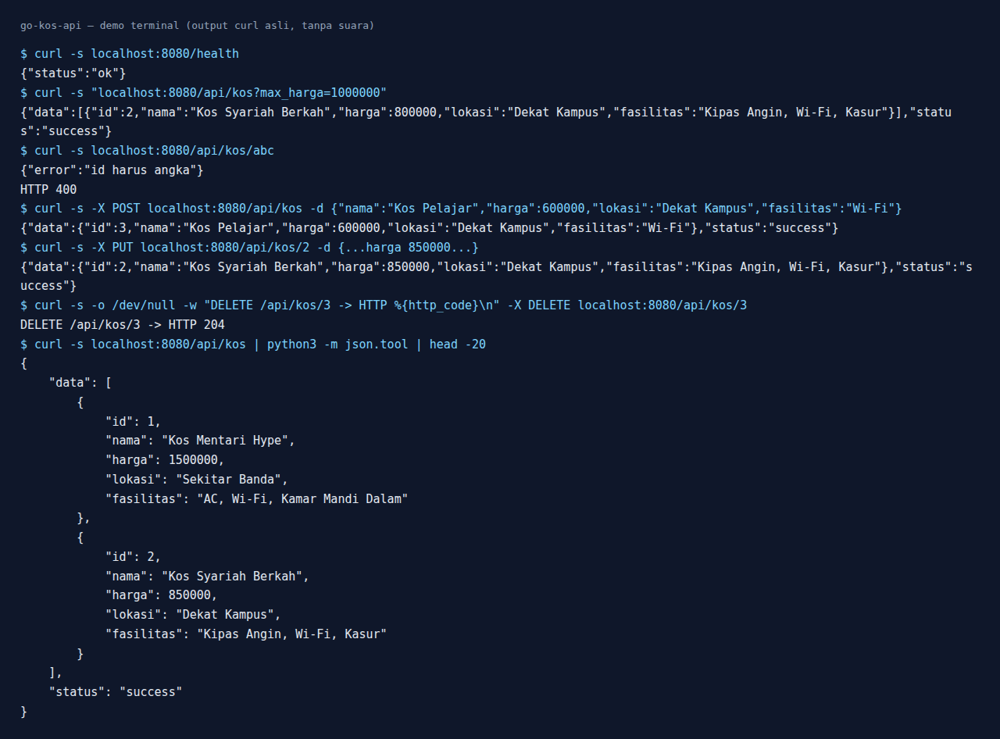
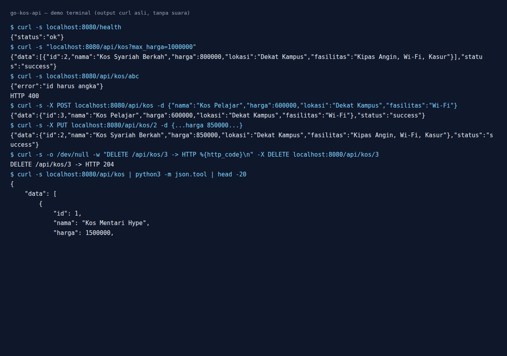

# go-kos-api

REST API sederhana untuk daftar kost — cari kos berdasarkan lokasi dan harga,
tambah, ubah, dan hapus listing. Dibangun dengan Go + Fiber, data disimpan di
memori (tanpa database).

> **Demo & dokumentasi interaktif:** https://go-kos-api.pages.dev

[](https://github.com/dezzorigin/go-kos-api/actions/workflows/ci.yml)
[](LICENSE)

## Yang bisa dilakukan API ini

| Endpoint | Fungsi |
|---|---|
| `GET /health` | Cek server hidup (`{"status":"ok"}`) |
| `GET /api/kos` | Daftar semua kos |
| `GET /api/kos?lokasi=kampus` | Filter lokasi (substring, case-insensitive) |
| `GET /api/kos?min_harga=500000&max_harga=1000000` | Filter rentang harga/bulan |
| `GET /api/kos/:id` | Satu kos berdasarkan ID |
| `POST /api/kos` | Tambah kos baru |
| `PUT /api/kos/:id` | Ubah kos |
| `DELETE /api/kos/:id` | Hapus kos |

Bentuk data kos:

```json
{
  "id": 1,
  "nama": "Kos Mentari Hype",
  "harga": 1500000,
  "lokasi": "Sekitar Banda",
  "fasilitas": "AC, Wi-Fi, Kamar Mandi Dalam"
}
```

Respons sukses: `{"status": "success", "data": ...}`.
Respons error: `{"error": "pesan"}` dengan status HTTP yang sesuai
(400 input tidak valid, 404 tidak ditemukan).

## Menjalankan

Butuh Go 1.26+.

```bash
git clone https://github.com/dezzorigin/go-kos-api.git
cd go-kos-api
go run .
# server jalan di http://localhost:8080
```

Port bisa diubah lewat environment variable:

```bash
PORT=3000 go run .
```

Build biner:

```bash
go build -o go-kos-api .
./go-kos-api
```

## Contoh pemakaian (curl)

```bash
# Semua kos
curl localhost:8080/api/kos

# Kos di bawah Rp1.000.000
curl "localhost:8080/api/kos?max_harga=1000000"

# Kos di sekitar kampus
curl "localhost:8080/api/kos?lokasi=kampus"

# Satu kos
curl localhost:8080/api/kos/1

# Tambah kos (nama wajib, harga harus > 0)
curl -X POST localhost:8080/api/kos \
  -H 'Content-Type: application/json' \
  -d '{"nama":"Kos Pelajar","harga":600000,"lokasi":"Dekat Kampus","fasilitas":"Wi-Fi"}'

# Ubah harga kos id 2
curl -X PUT localhost:8080/api/kos/2 \
  -H 'Content-Type: application/json' \
  -d '{"nama":"Kos Syariah Berkah","harga":850000,"lokasi":"Dekat Kampus","fasilitas":"Kipas Angin, Wi-Fi, Kasur"}'

# Hapus kos id 3
curl -X DELETE localhost:8080/api/kos/3
```

Tangkapan layar sesi curl di atas (output asli dari terminal):



Video demo (tanpa suara, terminal direkam dari sesi curl asli):

[](docs/demo.mp4)

## Tes

```bash
go test -race -cover ./...
# ok  go-kos-api  coverage: 80.6% of statements
```

Tes mencakup: health, list + filter, get by id (200/404/400),
create (201 + validasi), update, delete, dan penomoran ID setelah hapus.

## Struktur proyek

```
.
├── main.go            # entrypoint: baca PORT, jalankan server
├── handlers.go        # route + validasi (newApp)
├── store.go           # penyimpanan in-memory (thread-safe)
├── main_test.go       # tes endpoint end-to-end via app.Test
├── go.mod / go.sum
├── landing/           # halaman dokumentasi statis (Cloudflare Pages)
└── docs/
    ├── api.md         # referensi endpoint lengkap
    ├── architecture.md
    ├── deployment.md
    └── diagram.svg    # diagram arsitektur
```

## Batasan yang perlu diketahui

- **Data di memori saja.** Semua kos (termasuk yang ditambah lewat POST)
  hilang saat server berhenti. Belum ada database.
- **Data contoh bawaan** (2 kos: Kos Mentari Hype, Kos Syariah Berkah)
  adalah contoh statis, bukan listing sungguhan.
- **Tanpa autentikasi.** Siapa pun yang bisa mencapai server bisa
  menambah/mengubah/menghapus data. Jangan expose langsung ke internet
  tanpa auth di depannya.

## Dokumen

- [PRD](PRD.md) — tujuan, ruang lingkup, kriteria keberhasilan
- [docs/api.md](docs/api.md) — referensi endpoint lengkap
- [docs/architecture.md](docs/architecture.md) — arsitektur & keputusan desain
- [docs/deployment.md](docs/deployment.md) — cara deploy
- [CHANGELOG](CHANGELOG.md) — riwayat versi

## Lisensi

MIT — lihat [LICENSE](LICENSE).
