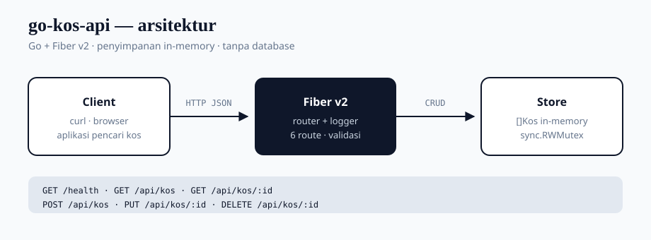

# Arsitektur — go-kos-api



## Gambaran

```
Client (curl / browser / aplikasi)
        │  HTTP JSON
        ▼
Fiber v2 (router + logger middleware)
        │
        ├─ GET  /health
        ├─ GET  /api/kos            (+ filter lokasi / harga)
        ├─ GET  /api/kos/:id
        ├─ POST /api/kos
        ├─ PUT  /api/kos/:id
        └─ DELETE /api/kos/:id
        │
        ▼
Store (in-memory, sync.RWMutex)
  []Kos — 2 data contoh bawaan
```

## File

| File | Isi |
|---|---|
| `main.go` | Entrypoint: baca env `PORT` (default 8080), jalankan server |
| `handlers.go` | `newApp(store)` — semua route, parsing query/body, validasi |
| `store.go` | `Store` — slice `[]Kos` + `sync.RWMutex`, operasi List/Filter/Get/Create/Update/Delete |
| `main_test.go` | Tes endpoint lewat `app.Test` (tanpa menyalakan server) |

## Keputusan desain

1. **Tanpa database (v1).** Sengaja: API ini dibuat untuk prototipe dan
   pembelajaran. Konsekuensinya dinyatakan jujur di README — data hilang
   saat server berhenti. Database (SQLite/Postgres) masuk roadmap, bukan
   diklaim sudah ada.
2. **Store terpisah dari handler.** Handler tidak menyentuh slice secara
   langsung; semua akses lewat method `Store` yang terkunci mutex, jadi
   aman dipakai Fiber yang melayani request secara konkuren.
3. **`newApp` bisa diuji tanpa server.** `main()` hanya wiring
   (PORT + Listen); seluruh logika route hidup di `newApp`, sehingga tes
   memakai `app.Test` dan berjalan cepat tanpa port.
4. **ID = max + 1.** Versi lama memakai `len + 1`, yang tabrakan bila ada
   data yang dihapus. Sekarang ID baru selalu lebih besar dari semua ID
   yang ada.
5. **Error konsisten.** Semua error memakai envelope `{"error": "..."}` dan
   status HTTP yang benar: 400 input tidak valid, 404 tidak ditemukan.
   Fiber `ErrorHandler` kustom memastikan error framework pun memakai
   format yang sama.
6. **Satu dependency.** Hanya Fiber v2 (+ middleware logger bawaan).
   Tidak ada ORM, tidak ada framework validasi — validasi ditulis manual
   (`validateKos`) supaya perilakunya transparan.

## Alur request (contoh: POST /api/kos)

1. Fiber menerima request, logger mencatat method + path + status.
2. Handler mem-parse body JSON → gagal: 400.
3. `validateKos`: nama kosong atau harga ≤ 0 → 400.
4. `Store.Create`: kunci mutex, hitung max ID, tambah item, buka kunci.
5. Respons 201 + `{"status":"success","data":{...}}`.

## Batasan yang disadari

- Penyimpanan in-memory: tidak tahan restart, tidak bisa di-scale ke
  banyak instance (tiap instance punya datanya sendiri).
- Tanpa autentikasi: siapa pun bisa mengubah data.
- Tanpa pagination: list mengembalikan semua data sekaligus.
- Tidak ada rate limiting.
